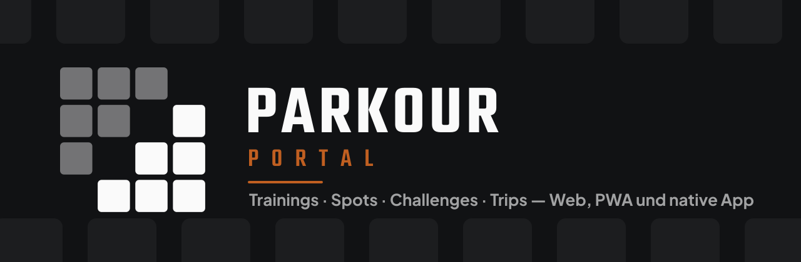

<p align="center">
  
</p>

<p align="center">
  <a href="#features"></a>
  <a href="#tech-stack"></a>
  <a href="#lizenz"></a>
</p>

# Parkour Training Portal

Ein selbst gehostetes Portal für Parkour-Gruppen. Verwaltet Trainings, Spot-Datenbank, Spot-Voting, Challenges, Trips, Statistik und vieles mehr.

Gebaut für unsere Trainingsgruppe im Raum Thun/Bern, aber so aufgebaut, dass es jede Parkour-Gruppe nutzen kann.

Das Projekt besteht aus drei Teilen mit **einem** Server als Herzstück:

| Teil | Was es ist | Wo |
|---|---|---|
| **Website** | SvelteKit-App, Produktion auf Port 3000 | `src/` |
| **PWA** | Dieselbe Website, installierbar (v. a. iPhone), inkl. Push | `src/service-worker.ts`, [docs/APP.md](docs/APP.md) |
| **Native Android-App** | Eigenständige React-Native-App (kein WebView), lädt Updates direkt vom Portal | `native/`, [native/README.md](native/README.md) |

Die native App spricht mit dem Server über die JSON-API (`/api/v1/…`, Bearer-JWT, siehe [docs/API.md](docs/API.md)) und bekommt JS-Updates über den eingebauten Update-Server (`/api/expo/manifest`) — ohne Play Store. Die APK zum Installieren liegt auf der Portal-Seite **`/app`**.

**Bedienung für Mitglieder & Admins:** [docs/BENUTZER-ANLEITUNG.md](docs/BENUTZER-ANLEITUNG.md) (Tutorial / How-to).

## Features

### Training
- Trainings werden automatisch generiert (standardmässig Di + Do, 18:15–20:15)
- Übersicht **Zieht** vs. **Zieht nicht** (Abmeldung nur mit Begründung, mind. 10 Zeichen)
- Optionaler Modus **nur mit Zusage** (Opt-in) und **Auto-Abmeldung** an festen Wochentagen (Admin pro User; erfordert DB-Migrationen 0002/0003)
- Spot-Voting pro Termin. Schluss ist der **frühere** von „2 h vor Beginn“ und **16:15** — wird das Training nach hinten verschoben (19:00 statt 18:15), steht der Spot trotzdem um 16:15; beginnt es früher, gilt Beginn − 2 h. Beim **Zusatztraining** erst mit dem Beginn, da es oft spontan innerhalb dieser 2 h eingetragen wird. Wer abgemeldet ist, kann nicht voten, Gäste eintragen, Admins können User pro Session aus der „Zieht“-Liste ausblenden
- **Zusatztraining** eintragen (App und Web, Knopf „⊕ Zusatztraining“ neben „Nächste Trainings“ bzw. auf der Trainingsseite): ein Formular mit Umschalter **„Mit der Gruppe | Solo“** — Solo trägt ein eigenes Training ein (heute oder bis 14 Tage zurück, mit Notiz; ist heute schon eines drin, bietet das Formular „Rückgängig“). „Mit der Gruppe“ ist ein spontaner Termin neben Di/Do, mit Datum, Zeit und Notiz. Jedes Mitglied darf einen anlegen, alle werden benachrichtigt, Anmeldung und Spot-Voting laufen wie bei den festen Terminen. Anmeldung läuft anders als beim festen Termin: Beim Zusatztraining zählt **nur die ausdrückliche Zusage** („Dabei!"), auch für Accounts im Standardmodus — sonst stünde jede:r drin, der bloss nichts gemacht hat. Eine stehende Wochentags-Abmeldung gilt weiterhin nur dem regulären Termin. In „Gezogen %" und die Hall of Fame fliessen Zusatztrainings bewusst **nicht** ein; zusammen mit den Solo-Trainings erscheinen sie als eigene Wertung **Extra-Einheiten** (Statistik-Seite und Profil). Wer nichts anklickt, steht als **„noch keine Antwort“** in der Liste — weder dabei noch abgemeldet. Damit das niemand verpasst, fragt ein Dialog beim Öffnen von App und Portal nach (wie beim Trip; „Später“ vertagt ihn um zwei Stunden), und drei Stunden vor Beginn geht eine Push-Erinnerung an alle ohne Antwort. Die Absage braucht hier keinen Grund. Ein Admin kann im Admin-Bereich (Web und App) Leute direkt **anmelden** (Zusage, `add_rsvp`) und **abmelden** (`remove_rsvp` bzw. als abwesend `add_absence`) — Zusatztrainings sind als solche gekennzeichnet. Entfernen darf den Termin der Ersteller oder ein Admin.
- **Kurzfristig abmelden (nach dem Spot-Schluss, feste Termine)** geht nur als Notfall: dreifache Bestätigung im Portal/in der App, danach ist der Name **eine Woche rot markiert** (Tabelle `late_absence_marks`, Feld `lateMarked` in den Listen); die Abmelde-Benachrichtigung trägt „kurzfristig!“ und die Minuten vorher. Zusatztrainings sind ausgenommen. Ein Admin kann die Markierung aufheben (`clear_late_mark`). Ziel: Abmelden mindestens zwei Stunden vorher, solange Spot und Planung noch reagieren können.
- **Strafrunde bei stillem Fernbleiben**: Trägt ein Admin jemanden ohne Grund als „nicht erschienen“ ein (reguläres Training, Datum heute oder früher), läuft automatisch bis zum nächsten Training eine spielerische Strafe, die sich **abwechselnd steigert**: **Stufe 1** — Warnhinweis beim Öffnen von App und Portal (20 Sekunden nicht wegklickbar) und **„Wer zieht“ nur als Fragezeichen**; **Stufe 2** — dasselbe plus beim nächsten Training ein **falscher Spot** (der nächstgelegene andere, auch im „Spot fix“-Push), ohne dass die Warnung es verrät — sie droht nur „weitere Konsequenzen“ an. Danach beginnt es wieder bei Stufe 1; der Zähler läuft über alle Strafen ohne Verfall (`no_show_penalties.stage`). Die Strafe endet mit dem Straf-Training von selbst; fällt es aus, wandert sie aufs nächste. Admin-Aktionen `no_show_penalty` (Nachtrag) und `remove_penalty` (Gnade); Tabelle `no_show_penalties`, Logik in `src/lib/server/noShowPenalty.ts`.
- **„Bin da"** am Trainingstag, sobald der Spot feststeht: Standort teilen und die anderen als Profilbild-Pins auf der Karte finden — sichtbar nur gegenseitig, Position verfällt nach 45 min (App und Web)
- Wetter-**Prognose je Training** (Dashboard und App), aber nur für die kommenden sieben Tage und nur wenn Open-Meteo wirklich Daten liefert (`hasData` — nicht aus `condition` ablesen, „unsicher“ ist auch eine echte Wetterklasse); weiter entfernte Termine werden gar nicht erst abgefragt — weiter voraus ist es Raten, und eine Zeile „keine Daten“ hilft niemandem. Dazu die eigene **Streak oben rechts** im Kopf; Solo steckt im Zusatztraining-Formular (siehe oben).
- **Individuelle Avatare**: Wer kein Profilbild gewählt hat, bekommt ein generiertes, immer gleiches Muster (Identicon, aus dem Namen abgeleitet) statt bloss dem Anfangsbuchstaben — berechnet unter `/api/avatar/<name>`, ohne externen Dienst, in Web und App identisch
- **Solo-Training** mit optionaler Notiz eintragen — in App und Web über „⊕ Zusatztraining“ → „Solo“; zählt in die Extra-Einheiten, nicht in „Gezogen %"

### Spots
- Spot-Datenbank mit Name, Stadt, Koordinaten, Beschreibung
- Kategorien: Kerntechniken (Präzisionssprung, Flow, Armsprung, Drops, etc.), Wetter-Eignung (trocken/nass), Beleuchtung
- Adress-Suche über OpenStreetMap (Nominatim) oder manuelle Koordinaten
- Bilder-Upload pro Spot
- Satellitenkarte mit Pin auf der Spot-Detailseite
- Bewertungssystem (1–5 Sterne) mit Möglichkeit zum Entfernen
- Filter nach Stadt und Technik

### Spot-Voting fürs Training
- Vor jedem Training können Mitglieder Spots vorschlagen und dafür voten
- Der Spot mit den meisten Stimmen gewinnt
- Falls niemand voted: automatischer Vorschlag basierend auf aktuellem Wetter (Open-Meteo API)
- Voting schliesst 2 Stunden vor Trainingsstart
- Hinter der Karte **„Nächstes Training“** (Dashboard und App) liegt leise das Foto des Spots, der gerade vorne liegt: gesetzter Spot, sonst Gewinner bzw. Wetter-Vorschlag, und schon während des Votings der Spot mit den meisten Stimmen (bei Gleichstand alphabetisch, wie die Push-Meldung). Ist der Spot noch offen (nichts gesetzt, Voting läuft) und liegt keiner mit Foto vorne, steht dort ein grosses, leises **Fragezeichen** (Teko, gedreht; Web `.spot-open` in `src/routes/+page.svelte`, App `SpotOpenMark`) — bewusst kein Foto eines anderen Spots, das sähe aus, als stünde der Spot schon fest. Ist der Spot fix und hat kein Foto, bleibt die Karte ohne Bild, ebenso bei einem abgesagten Training

### Spot-Finder
- Schritt-für-Schritt Quiz: Wetter (automatisch oder manuell), Stadt, Technik
- Zeigt die besten passenden Spots sortiert nach Bewertung
- Direkt aus den Ergebnissen fürs nächste Training voten

### User-System
- Registrierung nur per Einladungslink (kein offenes Signup)
- Drei Rollen:
  - **Admin**: Volle Kontrolle (User-Verwaltung, Trainings-Administration, Spot-Papierkorb, Passwort-Reset, Rollen, Audit-Protokoll)
  - **Spot-Manager**: Spots hinzufügen und bearbeiten
  - **Mitglied**: Standard-Rolle, kann Spots hinzufügen, voten, am Training teilnehmen
- Passwort ändern in den Einstellungen

### Statistik
- **Ø pro Training** folgt dem Zeitraum: In der App zeigen die Kacheln oben (Trainings, Abmeldungen, Ø pro Training) den Monat, der in der Hall of Fame gewählt ist („Gesamt“ = alles seit Beginn). Im Web steht der Schnitt in der Zeile über der gefilterten Tabelle („… · Ø 2.8 pro Training“), auch für Jahr und freien Bereich. Gerechnet wird wie der Gesamtschnitt (`pulledCount` / `avgPulledPerSession` je Monat in `monthDetail`); bei Jahr/Bereich alle Gezogenen durch alle Trainings, nicht der Schnitt der Monatsschnitte.
- **Zug-O-Meter** auf dem Dashboard (Web und App): wie gut die Gruppe gerade zieht — über **letzte, diese und nächste Kalenderwoche** (Mo–So, also meist sechs Trainings): Vergangenes als Tatsache, Kommendes mit dem aktuellen Stand der An-/Abmeldungen; nur reguläre, nicht abgesagte Trainings. Die Stufe hängt am **Schnitt der Köpfe pro Training**, die Grenzen (`LEVEL_MIN`) sind an der echten Gruppe angesetzt: In 45 Trainings (Juni–Nov. 2026) waren nie alle sechs da, über drei Wochen gemittelt lag der Rekord bei ⌀ 3,7. Darum (Grossartig bewusst knapp über dem Rekord, damit es ein echtes Ziel bleibt): ab ⌀ 4,0 → **Grossartig 🔥🔥🔥** (grün mit grünem Feuer), 3,5–3,9 → Super 🔥 (grün), 3,1–3,4 → Gut 💪 (gelb), 2,7–3,0 → Geht so 😬 (orange), 2,0–2,6 → Sehr schwach 😭 (rot), unter 2,0 → **Katastrophe 💀** (dunkelrot). Bis 24.11.2026 lagen die Grenzen bei 4,2 / 3,8 / 3,4 / 3,0 / 2,5 — im Winter stand es damit dauernd auf Katastrophe. Verglichen wird der angezeigte Schnitt mit einer Nachkommastelle, ⌀ 2,7 in der Anzeige ist also auch „Geht so“. Der Balken zeigt die Stufe (`fillFor()`: je Stufe ein Sechstel, innen anteilig; Grossartig immer ganz voll), nicht die rohe Anwesenheit. Ist die Gruppe kleiner, gilt „alle da“ trotzdem als grossartig. Sprüche je Stufe: „Maximaler Zug!!!“, „Zugmodus aktiviert!“, „Der Zug kommt ins Rollen“, „Wo ist der Zug?“, „Der Zug steht still.“, „Zugausfall!“. Der Spruch steht in einer Zeile neben der Stufe („😬 Geht so · Wo ist der Zug?“), so gross wie möglich: höchstens 17 px, und auf schmalen Handys füllt die Schrift genau die Zeile, statt umzubrechen — kurze Stufen wie „💀 Katastrophe · Zugausfall!“ werden darum grösser als lange. Web: `cqi`-Schriftgrösse geteilt durch die aus der Zeichenzahl geschätzte Zeilenbreite (`lineEm` in `ZugOMeter.svelte`: Titel 7,4 em, Emoji 1,25 em, sonst 0,445 em je Zeichen, plus 3 % Reserve); App: Grundgrösse 17 mit `adjustsFontSizeToFit`. Admin-**Vorschau** aller sechs Stufen: Web `/admin/zug-o-meter` (Link im Admin-Tab „Trainings“), App Admin → Trainings → „Zug-O-Meter-Vorschau“; Muster aus `zugkraftPreview()`, API `GET /api/admin/zugkraft-preview`.
- Bewusst schlank: eine Kopfzeile (Emoji, ⌀ dabei von Mitgliedern, Stufe, Trend), ein Balken, ein Satz — Details per Klick in der Statistik. Farbe und Leuchten stecken **nur im Balken** — der Block drumherum bleibt ruhig. Der Schein liegt als eigene Ebene über dem Balken (Web: `::after`, App: `boxShadow`, ab RN 0.76 und in der installierten APK nativ vorhanden) und **atmet bei allen Stufen** über seine Deckkraft: langsam im Normalfall, schnell und kräftig bei den zwei schlechtesten Stufen. Bei Grossartig lodert grünes Feuer aus dem Balken: ein flackerndes Glutband und darauf 64 Flammenzungen (Tropfen mit weichem Verlauf), die aufsteigen, sich in die Länge ziehen und verlöschen (feste Formel, in Web und App gleich; Web per CSS-Animation, App über `experimental_backgroundImage` und den nativen Animationstreiber). „Bewegung reduzieren“ schaltet die Animationen ab, der ruhige Schein bleibt.
- Nenner sind **alle** Mitglieder, auch wer eine stehende Wochentags-Abmeldung hat — ein dünn besetzter Donnerstag ist auch fehlende Zugkraft; nur Zusage-Accounts, die im Fenster nie geantwortet haben, bleiben draussen. Sonntag ab 19:00 geht ein **Wochenbericht** per Push („😬 Zug-O-Meter: Geht so“ plus Spruch und Tendenz, ohne Kopfzahlen) (Reminder-Schlüssel je Kalenderwoche, also höchstens einmal). Logik in `src/lib/server/zugkraft.ts`. Seit 23.11.2026 für **alle Mitglieder** sichtbar (ausser „Nur Zusage“-Accounts — die sind eher Gäste und sehen weder Anzeige, Wochenbericht noch Schalter; Regel in `zugkraftVisibleTo()`), der Wochenbericht geht an alle, die ihn nicht abgeschaltet haben (Einstellungen → Benachrichtigungen → „Zug-O-Meter-Wochenbericht“, in Web und App). `ZUGKRAFT_ADMIN_ONLY = true` schaltet Anzeige und Push wieder auf Admins zurück (Probelauf).
- **Bildschirm-Alarm** bei **Katastrophe** (Web und App): Zusätzlich zum pulsierenden Balken pulsiert ein **roter Rahmen um den ganzen Bildschirm** — auf jeder Seite, nicht nur auf dem Dashboard. **Gleiche Farbe** wie der Katastrophe-Balken (#991b1b), **ohne Linie**: nur weicher Schein vom Rand nach innen (drei Lagen ohne Spread am Rand, wie eine Vignette). Atmet langsam und gleichmässig im eigenen Takt (3,2 s, Sinus 0,3 → 1 → 0,3): Web per `alternate` mit easeInOutSine, App als **eine** nativ endlos laufende Animation mit Sinus-Abbildung — eine `Animated.sequence` in `Animated.loop` würde jede Runde über JavaScript neu gestartet und am Umkehrpunkt stocken. Klicks gehen durch, bei „Bewegung aus“ steht er still. Web: `.zug-screen-alarm` in `src/app.css`, eingeblendet im Root-Layout über `zugAlarm` aus `+layout.server.ts` (läuft bei jeder Live-Änderung neu mit). App: `native/src/lib/ZugAlarmFrame.tsx` im Root-Layout, fragt `GET /api/v1/zug-alarm` (`{ alarm }`) beim Start, bei Rückkehr in die App, jede Minute und sofort nach frisch geladenen Trainingsdaten (höchstens alle 5 s). Wer ihn sieht, entscheidet der Server (`zugAlarmFor()` in `zugkraft.ts`): seit 24.11.2026 **alle, die das Zug-O-Meter sehen** (also nicht „Nur Zusage“-Accounts); `ZUG_ALARM_ADMIN_ONLY = true` schaltet ihn ohne App-Update wieder auf Admins zurück (Probelauf).
- **Abmeldegründe-Verlauf**: Alle ausdrücklichen Abmeldungen vergangener Trainings mit Grund, neueste zuerst (Statistik-Seite und App) — filterbar nach Person, im Web zusätzlich Textsuche im Grund. Zu späte Abmeldungen tragen ein rotes „N Min. zu spät“ (gemessen ab Spot-Schluss), vom Admin nachgetragene Einträge ein neutrales „Admin“ (erkannt am Audit-Log, nicht am Grundtext), Zusatztrainings und abgesagte Termine sind gekennzeichnet. Die Trainingsseite zeigt nur kommende Termine; dies ist die Stelle zum Nachlesen.
- Zusage-Accounts, die nie zu- oder abgesagt haben, erscheinen nicht in der Rangliste (0 % ohne Teilnahme ist keine Aussage); mit der ersten Zusage oder Abmeldung tauchen sie von selbst auf
- Übersicht Trainingsbeteiligung pro Mitglied (geschätzt, ab Registrierung; nutzt dieselben Regeln wie die Trainingsseite, inkl. Opt-in/Auto-Abmeldung wenn migriert)

### Admin-Bereich
- **Trainingszeit ändern** (`set_time`, Web und App): neue Von-/Bis-Zeit plus optionaler Grund — Push an alle mit Gerät, Eintrag im Aktivitäts-Feed
- **Spot nachträglich setzen** (`set_spot`, auch für vergangene Trainings): „wir waren spontan woanders“ — der gesetzte Spot schlägt in der Statistik das Voting. Bei einem gelaufenen Training gibt es dabei **keine Benachrichtigung und keinen Feed-Eintrag** (reine Statistik-Korrektur); nur für kommende Trainings werden die Mitziehenden informiert. Gleiches gilt für `set_time`.
- **User**: Passwort zurücksetzen, Rolle ändern, Trainingsmodus (wie alle / nur Zusage), Auto-Abmeldung Wochentage, deaktivieren/aktivieren, **Papierkorb** (User aus allen Listen nehmen) und im Papierkorb **wiederherstellen** oder **endgültig löschen** (inkl. eigener Spots, Bilder, Votes, Trainingsdaten; Migration `0004_user_deleted.sql`)
- **Trainings**: kommende Termine, Gäste, Abwesenheiten, Spot-Votes, ausgeblendete User verwalten
- **Spots**: Bearbeiten; **Papierkorb** mit Wiederherstellen (kein permanentes Spot-Löschen über die UI)
- Einladungslinks erstellen und verwalten, Server-Infos, Audit-Log

### Challenges
- Spot-Quests: pro Spot Aufgaben anlegen, mit Foto/Video belegen
- Wer hat was geschafft — Leaderboard und offene Quests pro Person

### Trips
- Ausflüge planen: Terminumfrage, Zielort-Abstimmung, Zwischenstopps (Ortssuche) — die frühere separate „Ablauf“-Abstimmung ist weg, Ablauf gehört in die Notizen (weniger Knöpfe, weniger Hin und Her)
- **Terminumfrage statt Einzelstimme**: Jede Person sagt bei **jedem** Datum *Ja / Notfalls / Nein* (`trip_date_answers`). Das geplante Datum ist immer die erste Option. Sobald ein Datum **drei Ja** hat, ist der Termin fix; wer Ja gesagt hat, ist damit angemeldet. Jeder Trip hat eine **Frist** (Standard: eine Woche): 48 h davor erinnert der Scheduler die Stummen, mit Ablauf entscheidet er — meiste Ja, dann meiste Notfalls, dann das frühere Datum; fehlen drei Ja, bleibt der Trip offen und fixiert sich mit der dritten. **Wer bis zur Frist nichts sagt, sieht nur noch Titel und Datum**, bis er zusagt. Nach der Fixierung kann nur der Ersteller oder ein Admin den Termin **neu aufrollen** (mit neuer Frist). Logik in `src/lib/server/tripDatePoll.ts`; die alte Einzelstimme (`vote_date_option`) wird als „Ja“ weiter angenommen.
- Der nächste Trip steht als **eine Zeile** auf der Startseite (App und Web) — hervorgehoben, solange die eigene Antwort fehlt; der Start-Dialog verlinkt bei offener Umfrage direkt hinein.
- Zusagen mit Transportmittel (Mitfahrt, Auto, Motorrad, Zug, unentschlossen)
- **Admin setzt Teilnehmer selbst** (dabei / nicht dabei / offen) — im Web per Auswahl unter der Teilnehmerliste, in der App per langem Druck auf den Namens-Chip. Aktion `admin_set_participant`; „dabei“ zählt als Ja zum geplanten Datum und kann die Fixierung auslösen.

### Native Android-App
- Alle Funktionen der Website als echte native App (Tabs: Finder · Spots · Start · Arena · Mehr)
- Native MapLibre-Karte (Strasse/Satellit) mit Filtern und eigenem Standort, Fotos direkt von Kamera/Galerie
- Aktualisiert sich vom eigenen Server — Details in [native/README.md](native/README.md). Neue Versionen werden im Hintergrund geladen; liegt eine bereit, fragt ein Hinweis „Neue Version bereit — Jetzt neu starten?“ („Später“ fragt bei der nächsten Rückkehr wieder). **Pflicht-Update:** Steht `OTA_UPDATE_PFLICHT = true` (`src/lib/appVersion.ts`, an die App als `otaPflicht` in `/api/v1/app-version`), kommt der Hinweis **ohne „Später“** und lässt sich nicht wegklicken — nur neu starten. Seit 24.11.2026 eingeschaltet; wirkt in jeder App, die schon ein Bundle ab diesem Tag hat (ältere Bundles kennen den Schalter nicht und fragen noch einmal mit „Später“, übernehmen das Update aber spätestens beim nächsten Kaltstart). Massgeblich ist `useUpdates().isUpdatePending`, das auch Updates erfasst, die der native Abruf beim Start (ON_LOAD) schon geladen hat — gefragt wird aber nur, wenn das geladene Update nicht schon läuft (`downloadedUpdate.updateId` ≠ `Updates.updateId`): Lädt der Start ein Update rechtzeitig, startet die App gleich damit, und expo-updates meldet es trotzdem weiter als „pending“. „Jetzt neu starten“ (und „Nach Update suchen“ unter Mehr) baut vor dem Neustart den ganzen Bildschirm ab („Neue Version wird gestartet …“) und startet ab **APK 1.11** die App über ein eigenes Modul wirklich neu (neuer Prozess, siehe native/README.md) — `reloadAsync()` beendete auf APK 1.10 die App nur. Auf 1.10 sagt der Hinweis darum: „Zum Übernehmen schliesst sich die App – danach bitte wieder öffnen.“ Ob der Neustart geklappt hat, meldet die App beim nächsten Start ins Fehlerprotokoll („Neustart für Update geklappt“ bzw. „App war zu, von Hand neu geöffnet“, mit `restartCount` und Fehlern aus `Updates.readLogEntriesAsync`; `native/src/lib/updateRestart.ts`)
- Fehlt die Benachrichtigungs-Berechtigung, zeigt die Startseite einen schmalen Hinweis mit Weg in die Android-Einstellungen („Später“ vertagt ihn um drei Tage) — Android fragt nach einer Ablehnung nie wieder von selbst

### Benachrichtigungen (drei Kanäle, ein Versand)
- **Web-Push** (VAPID) für Browser und PWA
- **Firebase/FCM** für die native App ab 1.4 — weckt sie auch geschlossen; Dienstkonto liegt ausserhalb des Repos (`backups/firebase/`)
- **ntfy** als Google-freie Option (geheimes Thema pro Person, Server per `NTFY_BASE` wechselbar)
- Auslöser u. a.: Training-Erinnerung, Zusage-Erinnerung, Spot fix (16:15), Spot-Voting eröffnet, neuer Spot, Challenge angelegt/geschafft, Trips, **Abmeldungen** (wer sich mit welchem Grund von einem Training abmeldet), **„X ist am Spot"** (beim ersten Standort-Teilen, einmal pro Person und Training, nur von zwei Stunden vor bis eine Stunde nach dem Training), Admin-Broadcast — pro Person einzeln abschaltbar

## Tech Stack

- **Frontend & Backend**: [SvelteKit](https://kit.svelte.dev/) (Svelte 5)
- **Native App**: React Native / [Expo](https://expo.dev) SDK 57, expo-router, self-hosted expo-updates, MapLibre
- **Datenbank**: SQLite über [better-sqlite3](https://github.com/WiseLibs/better-sqlite3)
- **ORM**: [Drizzle ORM](https://orm.drizzle.team/)
- **Styling**: [Tailwind CSS](https://tailwindcss.com/) v4, mehrere Farbschemata (Web und App identisch)
- **Auth**: bcrypt + JWT (Web: Cookie, App: Bearer-Token — siehe [docs/API.md](docs/API.md))
- **Wetter**: [Open-Meteo API](https://open-meteo.com/) (kostenlos, kein API-Key nötig)
- **Geocoding**: [Nominatim/OpenStreetMap](https://nominatim.org/) (kostenlos)

## Ordner-Überblick

```
src/                SvelteKit: Seiten, API-Routen, Server-Logik
  routes/api/v1/    JSON-API für die native App (Bearer-JWT)
  routes/api/expo/  Update-Server der nativen App (Manifest + Assets)
  routes/app/       Download-Seite und Auslieferung der APK
native/             Native Android-App (eigenes README)
docs/               API.md · APP.md (PWA/Push) · BENUTZER-ANLEITUNG.md
drizzle/            SQL-Migrationen
data/               Laufzeitdaten: parkour.db, uploads/, expo-updates/, app/ (nicht im Repo)
backups/            DB- und Code-Backups, Android-Signaturschlüssel
android/            Alte TWA-Hülle (durch native/ abgelöst)
```

**Regel vor jeder Änderung am Server:** zuerst Datenbank und Code sichern (`backups/`).

### Automatische Sicherung

`scripts/backup.sh` läuft täglich um 04:00 über den systemd-Timer
`parkour-backup.timer` (`Persistent=true` — nach einem Ausfall wird nachgeholt):

- Datenbank via `sqlite3 .backup` (WAL-sicher, eine simple Dateikopie kann
  mitten in einer Transaktion erwischt werden), Integritätsprüfung, gzip,
  14 Tage Aufbewahrung → `backups/db/`
- Bilder werden nach `backups/uploads/` gespiegelt — ohne Löschabgleich,
  damit versehentlich gelöschte Fotos dort erhalten bleiben

Die Unit-Dateien liegen als Kopie in `docs/systemd/`.
Prüfen: `systemctl list-timers parkour-backup.timer`,
von Hand auslösen: `sudo systemctl start parkour-backup.service`.

### Bilder

Hochgeladene Fotos werden beim Ablegen auf höchstens 2560 px Kantenlänge
gebracht (Handykameras liefern 4000–8000 px und 4–8 MB). Ausgeliefert wird
über `?w=120|240|480|960|1600`, gerechnete Fassungen liegen als WebP im
Zwischenspeicher — die Vollansicht nimmt 1600 px, nicht das Original.
`scripts/shrink-uploads.mjs` zieht denselben Schnitt einmalig über den
Bestand (`--apply` schreibt, ohne den Schalter wird nur gerechnet).

Jede hochgeladene Datei wird **ohne Metadaten** neu geschrieben (`src/lib/server/mediaSanitize.ts`):
Fotos ohne EXIF/GPS/Kamera (die EXIF-Drehung wird vorher angewendet),
Videos per `ffmpeg -c copy` ohne Neukodieren neu verpackt — Ort, Zeit und
Gerät fallen weg, die Drehung bleibt. `/uploads` ist ohne Login lesbar (die
App lädt Bilder ohne Sitzung), darum gehört nichts Privates in die Dateien.
Ausgeliefert werden nur Dateinamen, wie der Server sie vergibt; der
Vorschau-Ordner `.thumbs` ist von aussen nicht erreichbar, und beim Löschen
verschwinden alle Vorschaugrössen mit (`removeUploadFile()` in
`src/lib/server/uploads.ts`).

## Sicherheit

Zwei externe Audits (Aug. 2026) und eine eigene Prüfung (Nov. 2026) haben
je eine Runde Befunde geliefert; alle sind abgearbeitet. Was dabei gilt:

- **`JWT_SECRET` ist Pflicht.** Ohne gesetzte Variable (mind. 16 Zeichen)
  verweigert das Portal den Dienst — früher gab es einen Standardwert im
  Quelltext, mit dem sich beliebige Sitzungen fälschen liessen.
- **`TRUSTED_PROXY_IPS`** listet die Adresse des eigenen nginx. Nur von dort
  wird `X-Forwarded-For` überhaupt beachtet, und dann zählt der letzte
  Eintrag (den hängt nginx selbst an). Ohne diese Liste ist die Sperre gegen
  Passwort-Raten mit erfundenen Adressen umgehbar.
- **Rolle kommt bei jeder Anfrage aus der Datenbank**, nicht aus dem Token.
  Eine Herabstufung wirkt damit sofort.
- **Abmelden entwertet das Token** (Tabelle `revoked_tokens`, Migration
  0029) — andere Geräte bleiben angemeldet. `logout-all` erhöht wie bisher
  `session_version` und wirft alle Geräte raus.
- **Sperren**: Login 5 Fehlversuche/Minute je Adresse und 20/15 min je
  Benutzername — jeder Versuch belegt seinen Platz vor dem Passwortvergleich,
  parallele Anfragen kommen also nicht vorbei; unbekannte Namen werden gleich
  lang geprüft wie bekannte. Passwortwechsel 5/15 min, Registrierung 10/h,
  Uploads (Bilder, Videos, Profilbild) 40/h je Person, Fehlerberichte 40/15 min.
- **Grösse von Anfragen**: über 1 MB nur auf den drei Upload-Endpunkten,
  alles andere bekommt 413 (Hook, zusätzlich zu `BODY_SIZE_LIMIT`).
- **Herkunft**: POST/PUT/PATCH/DELETE mit fremdem `Origin` werden abgelehnt
  (die App mit Bearer-Token ist ausgenommen). Öffentliche Pfade gelten nur
  exakt oder als Unterpfad (`/app` deckt nicht `/apps…` ab).
- **Abmelden** prüft und sperrt genau das Token, aus dem die Sitzung stammt
  (nicht einen mitgeschickten Bearer-Wert). JWT nur HS256.
- **Kalender-Abo**: persönlicher Link je Mitglied (`src/lib/server/calendarFeed.ts`,
  `<userId>.<HMAC>`), hängt an der Sitzungsversion — „Auf allen Geräten
  abmelden“ oder ein Passwortwechsel gibt einen neuen, deaktivierte Konten
  bekommen keinen. Der Schlüssel der Status-API (`PUBLIC_STATUS_API_KEY`)
  öffnet den Kalender nicht mehr.
- **App-Updates sind signiert** (expo-updates Code-Signing). Das Zertifikat
  steckt in der APK (`native/certs/certificate.pem`), signiert wird beim
  Veröffentlichen mit `backups/codesigning/private-key.pem` — **diesen
  Schlüssel nie verlieren und nie neu erzeugen**: APKs mit dem Zertifikat
  nehmen sonst kein Update mehr an. Ältere APKs prüfen keine Signatur.
- **Eingaben**: Freitext nur als Text, ohne Steuerzeichen, mit
  Längengrenze (`src/lib/server/inputLimits.ts`); Trip-Daten müssen echte
  Kalendertage sein, das Kalender-Abo überspringt kaputte Einträge.
- **Passwörter**: mind. 10 Zeichen, keine bekannten Wörter, nicht der eigene
  Name, nicht nur Ziffern (`src/lib/passwordPolicy.ts`).
- **Push-Ziele** werden gegen eine Liste bekannter Dienste geprüft, damit der
  Server nicht als Bote für interne Adressen missbraucht wird.
- **Namen, Spot- und Trip-Daten** werden vor jeder Ausgabe in Karten-Popups
  und -Beschriftungen maskiert (`src/lib/escapeHtml.ts`); Benutzernamen lassen bei der
  Registrierung nur Buchstaben, Ziffern, Leerzeichen und `. _ -` zu.

## Setup

### Voraussetzungen

- Node.js 18+
- npm

### Installation

```bash
git clone https://github.com/claudioDOC/parkour-portal.git
cd parkour-portal
npm install
```

### Datenbank einrichten

Die Datenbank ist nicht im Repo enthalten und muss lokal angelegt werden. Dazu erst den `data/` Ordner erstellen, dann die Migration und den Seed ausführen:

```bash
mkdir -p data
npx tsx src/lib/server/db/seed.ts
```

Der Seed wendet die SQL-Dateien aus `drizzle/` an, legt `data/parkour.db` an, erstellt einen Admin-User und die ersten Trainings-Sessions. Passwort direkt nach dem ersten Login ändern!

### Starten

**Entwicklung:**
```bash
npm run dev
```

**Produktion:**
```bash
npm run build
node build
```

Die App läuft standardmässig auf `http://localhost:5173` (Dev) bzw. `http://localhost:3000` (Produktion).

**Deployment / VPS:** Nach `git pull` immer **`npm ci`** (oder `npm install`) im Projektordner ausführen, danach **`npm run build`**. Ohne diesen Schritt fehlen neue Dependencies (`package-lock.json` ändert sich) — typischer Build-Fehler: *Rollup failed to resolve import "file-type"* o. Ä.

Wenn die Seite nach einem Deploy **HTTP 500** liefert und in den Logs SQLite-Fehler wie *no such column* stehen: **`npm run db:migrate`** ausführen (wendet `drizzle/*.sql` an; die Zieldatei steht zu Beginn in der Konsole). Danach Dienst neu starten. Alternativ einmalig **`npx tsx src/lib/server/db/seed.ts`** (Migrationen + ggf. Seed-Logik).

**Wichtig:** `db:migrate` schreibt standardmässig in **`data/parkour.db` im geklonten Repo** (nicht abhängig vom Shell-`cwd`). Die laufende Node-App öffnet dagegen **`$PWD/data/parkour.db`** — wenn dein systemd-`WorkingDirectory` z. B. `…/build` ist, migrierst du eine andere Datei als die App nutzt. Abhilfe: für App **und** Migration dieselbe absolute Datei setzen: Umgebungsvariable **`PARKOUR_DATABASE_PATH=/pfad/zu/parkour.db`** (in der systemd-Unit und ggf. vor `npm run db:migrate` auf dem Server).

### Konfiguration

- **JWT Secret**: Setze `JWT_SECRET` als Umgebungsvariable für Produktion
- **Read-only Status API (für KI/Automation/WhatsApp)**: Setze `PUBLIC_STATUS_API_KEY` (ein Key) oder `PUBLIC_STATUS_API_KEYS` (mehrere, komma-getrennt). Abruf über `GET /api/public/status/today`, `GET /api/public/status/next` und `GET /api/public/stats` mit Header `x-api-key: <key>` (alternativ `Authorization: Bearer <key>`). Antwort enthält kompakte Trainingsdaten inkl. Teilnehmer, Gäste, Abmeldungen, Spot-Votes und `summaryText` sowie aggregierte Statistiken/Leaderboards.
- **Rate-Limiting (Login / Registrierung)**: In der App pro Node-Prozess im Speicher — **5 fehlgeschlagene Login-Versuche / Minute** pro IP (erfolgreicher Login zählt nicht) und **10 Registrierungen / Stunde** pro IP (siehe `src/lib/server/rateLimitAuth.ts`). Hinter **nginx** muss die echte Client-IP durchgereicht werden, z. B. `proxy_set_header X-Forwarded-For $proxy_add_x_forwarded_for;`, sonst wirkt das Limit für alle Nutzer gemeinsam (eine IP). Optional zusätzlich `limit_req` in nginx für eine zweite Verteidigungslinie.
- **Hinter nginx/HTTPS (Produktion)**: Setze für den Node-Prozess **`ORIGIN=https://deine-domain`** (exakt die öffentliche URL, ohne Slash am Ende), siehe [adapter-node Environment](https://svelte.dev/docs/kit/adapter-node#Environment-variables). Ohne `ORIGIN` stimmen öffentliche URLs und **CSRF-Prüfung** nicht – dann schlagen POSTs (Login, Uploads, Admin) fehl. Beispiel systemd: `Environment=ORIGIN=https://matetraining.duckdns.org ...`
- **HTTPS erzwingen (App)**: Bei `NODE_ENV=production` leitet die App Anfragen mit `X-Forwarded-Proto: http` per **308** auf `https://…` um (nur wenn der Header gesetzt ist). In **nginx** also z. B. `proxy_set_header X-Forwarded-Proto $scheme;` setzen. Optional zusätzlich: `add_header Strict-Transport-Security "max-age=31536000" always;` nur auf dem HTTPS-`server`-Block.
- **PWA (App auf dem Handy installieren)**: Nach `npm run build` liefern Node/nginx **`/manifest.webmanifest`**, **`/sw.js`** und **`/workbox-*.js`** mit aus (wie andere statische Dateien). **Installieren geht nur über HTTPS.** Chrome/Android: Seite öffnen → Menü → „App installieren“ / „Zum Startbildschirm hinzufügen“. Wenn Updates der App „hängen bleiben“, in **nginx** für Service-Worker-Dateien kein langes Caching erzwingen, z. B. `location ~* ^/(sw\.js|workbox-.*\.js)$ { add_header Cache-Control "public, max-age=0, must-revalidate"; proxy_pass … }` (an dein `proxy_pass` anpassen).
- **Spot-Bild-Upload**: Zusätzlich zu Grösse/Format prüft der Server die **Dateisignatur** (Magic Bytes via `file-type`) — nur echtes JPEG/PNG/WebP, nicht nur Endung/Content-Type.
- **Bild-Upload (Produktion / VPS)**: Lokal funktioniert `vite dev` mit grösseren Bodies; der **Node-Adapter** begrenzt die Request-Grösse standardmässig stark (oft ~512KB). Ohne Anpassung schlagen grössere Fotos mit generischem „Upload fehlgeschlagen“ fehl. Setze für den Prozess z. B. `BODY_SIZE_LIMIT=10485760` (10MB, etwas über dem App-Limit von 5MB). Unter **nginx** zusätzlich im `server`-Block: `client_max_body_size 10M;` (Standard ist oft 1MB → 413 vor Node). Beispiel **systemd** unter `[Service]`: `Environment="BODY_SIZE_LIMIT=10485760"`.
- **SQLite-Schreibrechte**: Der User, unter dem `node build` läuft (systemd `User=`), braucht Schreibzugriff auf `data/parkour.db` und den Ordner `data/` (WAL-Dateien). Sonst: „attempt to write a readonly database“. Für Upload-Dateien derselbe User Schreibrechte auf `data/uploads/` (wird bei Bedarf angelegt).
- **Ohne Migration 0002/0003**: Die App startet weiter (Login, Spots, Training-Liste im **alten** Modus). Opt-in, Auto-Abmeldung und zugehörige Admin-Aktionen sind erst nach Anwenden der SQL-Migrationen auf der Server-DB aktiv; im Server-Log erscheint ein Hinweis.
- **Ohne Migration 0004** (`drizzle/0004_user_deleted.sql`): Die Spalte `users.deleted` fehlt — User-Papierkorb und endgültiges Löschen funktionieren erst nach Anwenden auf der Server-DB.
- **Ohne Migration 0005** (`drizzle/0005_session_version.sql`): Die Spalte `users.session_version` fehlt — App wirft DB-Fehler. Nach Anwenden: JWT enthält `sessionVersion`; nach Passwortänderung (oder Admin-Reset) sind alte Tokens ungültig.
- **Ohne Migration 0006** (`drizzle/0006_spots_deleted.sql`): Die Spalte `spots.deleted` fehlt — u. a. **Statistik** und Spot-Listen können mit *no such column: deleted* (HTTP 500) abbrechen. Nach `npm run db:migrate` ist der Spot-Papierkorb-Filter konsistent zum Schema.
- **Trainingszeiten**: Anpassbar in `src/lib/server/db/seed.ts`
- **Standard-Stadt für Wetter**: Thun (anpassbar in `src/lib/server/weather.ts`)

## Mitmachen

Issues und Feature-Requests sind willkommen! Nutze dafür die GitHub Issues. Wenn du einen Bug findest oder eine Idee hast, erstelle einfach ein Issue.

## Lizenz

MIT
